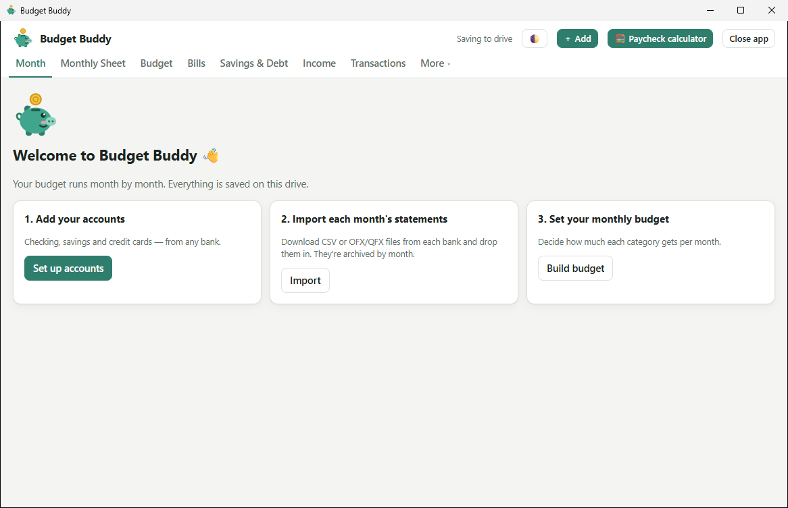
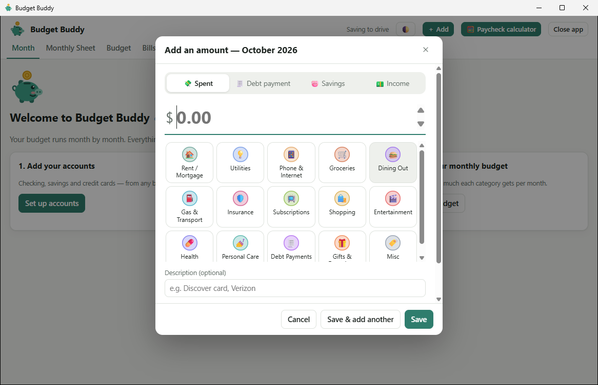
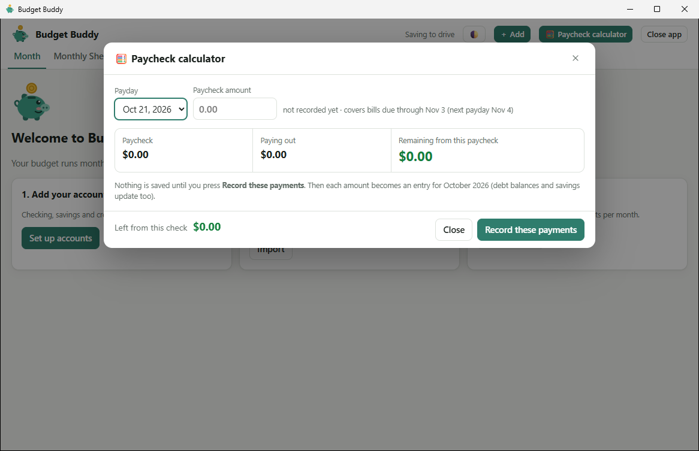
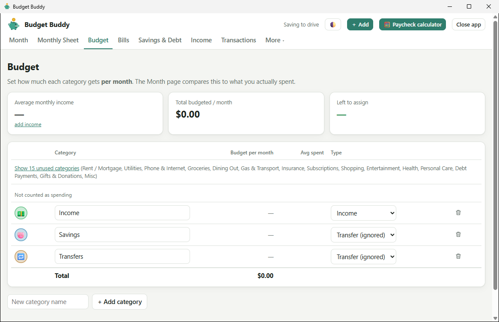
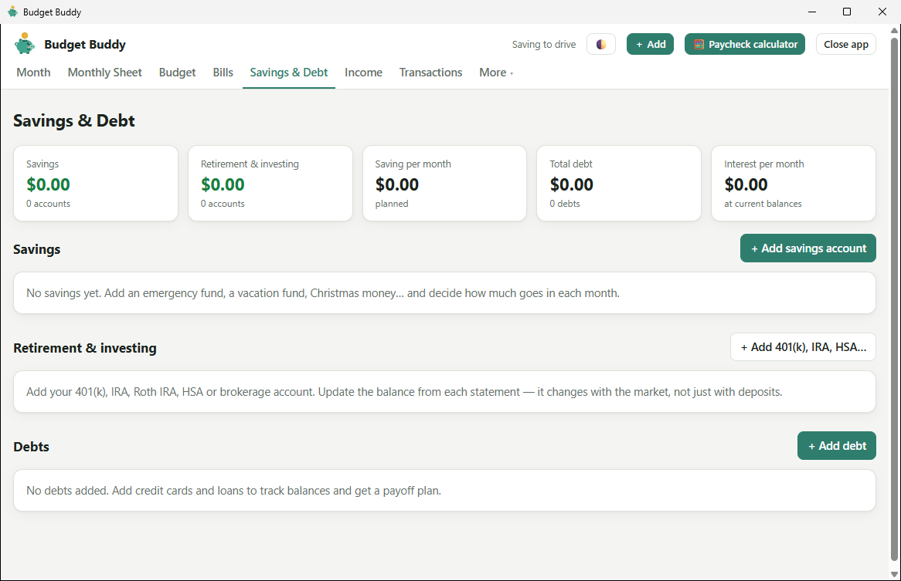
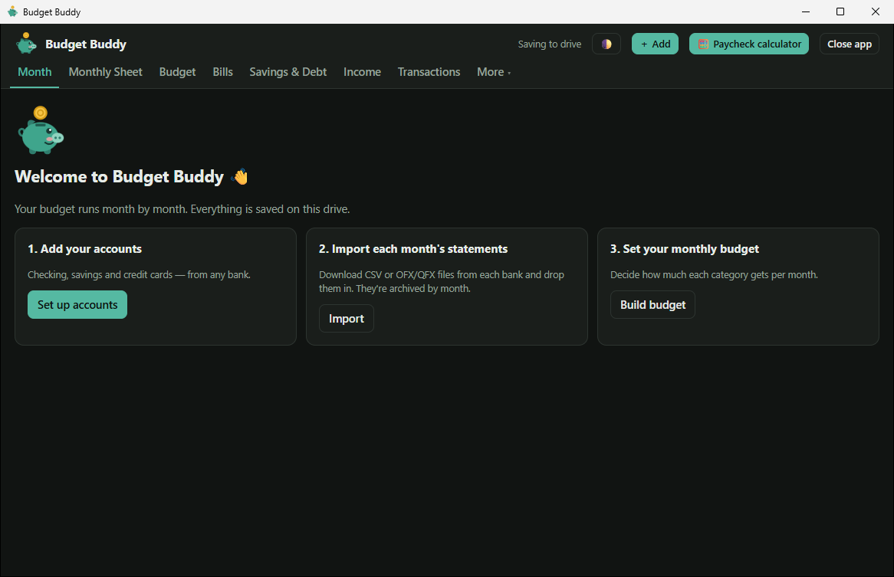

<p align="center">
  
</p>

<h1 align="center">Budget Buddy</h1>

<p align="center">
  A friendly monthly budget for Windows that lives on a USB drive.<br>
  No account, no cloud, no internet. Your money data never leaves the drive.
</p>

<p align="center">
  <a href="https://github.com/toxiicxmonster/budgetbuddy/releases/latest"><b>Download for Windows</b></a>
</p>



## What it does

- **Month by month.** See budget vs. spent for each category, what's left, what's due, and a "safe to spend" number that knows about the paychecks still to come.
- **Quick add.** Press **＋ Add** (or **N**), type an amount, tap a category. Debt payments, savings and income have their own tabs.
- **Import your bank statements.** PDF statements, CSV and OFX/QFX downloads. Duplicates, transfers between your own accounts and credit card payments are recognized, so nothing is counted twice. Rules learn your categories as you sort.
- **Bills.** What's due, what's paid, and a calendar with your paydays. Bills can be on autopay to a card.
- **Paycheck calculator.** Plan each check: cards, debt minimums, bills due before the next payday, savings, and what's left.
- **Savings & debt.** Emergency fund, sinking funds, 401(k)/IRA/HSA (as a dollar amount or a percent of pay), debts with payoff dates and an Avalanche/Snowball plan.
- **Monthly sheet & reports.** A spreadsheet-style view of the month, plus this month vs. last month vs. your average.
- **Close the month.** Confirm ending balances and next month's bills; every closed month is kept in an archive you can print.
- **Private by design.** Saved to `data\` next to the app, with a daily backup. Optional password encrypts your data and archived statements.
- **Light and dark.** Follows Windows, or pick one.

| | |
|---|---|
|  |  |
| **Quick add:** an amount and a category, that's it | **Paycheck calculator:** plan each check before you spend it |
|  |  |
| **Budget:** how much each category gets per month | **Savings & Debt:** goals, retirement accounts and payoff plans |



*Screenshots are from a fresh install with no data.*

## Get started

1. Download `BudgetBuddy-<version>-windows.zip` from the [latest release](https://github.com/toxiicxmonster/budgetbuddy/releases/latest).
2. Unzip it onto a USB drive (or anywhere you like).
3. Double-click **Budget Buddy.exe**.

Windows 10 or 11, nothing to install. The app isn't code-signed, so the first time Windows may say "Windows protected your PC": choose **More info → Run anyway**.

Your data is created in a `data` folder next to the exe. Close the window when you're done; it finishes saving first. `README.txt` in the download is the full user guide.

Prefer a browser? `Start Budget Buddy.bat` opens the same app in a browser tab instead.

## How it works

| Piece | What it is |
|---|---|
| `app/budget.html` | The whole app: one HTML file with no dependencies. |
| `desktop/` | `Budget Buddy.exe`, a small C# (.NET Framework 4.8) window that shows the app in WebView2 (the Edge engine built into Windows) and saves to `data\`. |
| `app/server.ps1` | The same saving helper in PowerShell, used by `Start Budget Buddy.bat`. |

Both helpers only listen on `localhost` and reject writes that don't come from the app.

### Build the exe

Needs the [.NET SDK](https://dotnet.microsoft.com/download) 8 or newer:

```powershell
powershell -ExecutionPolicy Bypass -File desktop\build.ps1            # builds "Budget Buddy.exe" next to app\
powershell -ExecutionPolicy Bypass -File desktop\build.ps1 -Package   # also makes dist\BudgetBuddy-<version>-windows.zip
```

The WebView2 libraries are embedded, so the result is a single ~1 MB exe.
